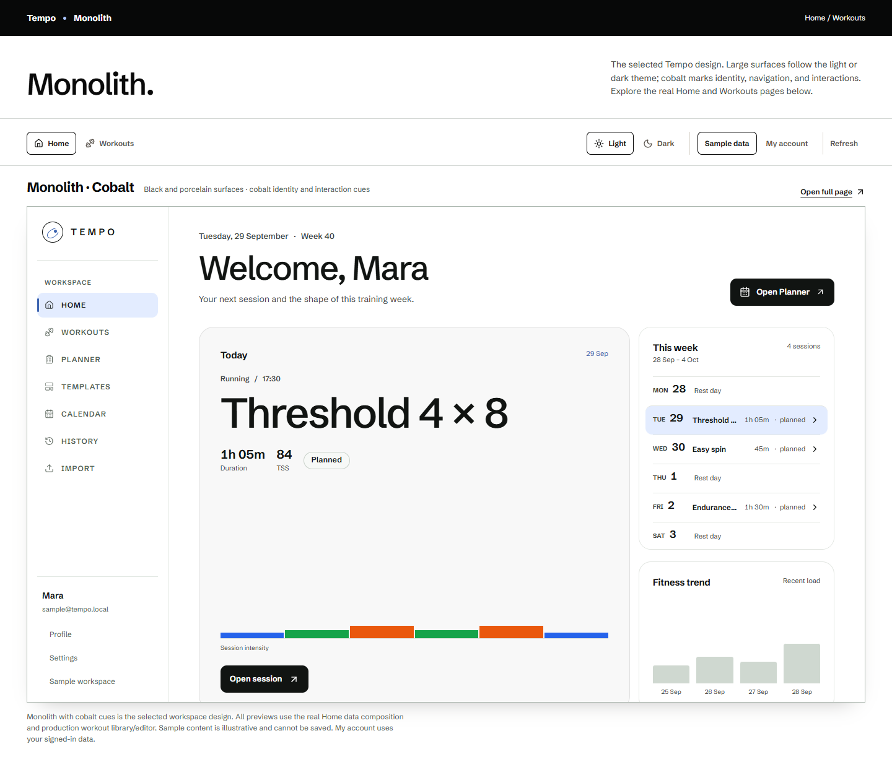
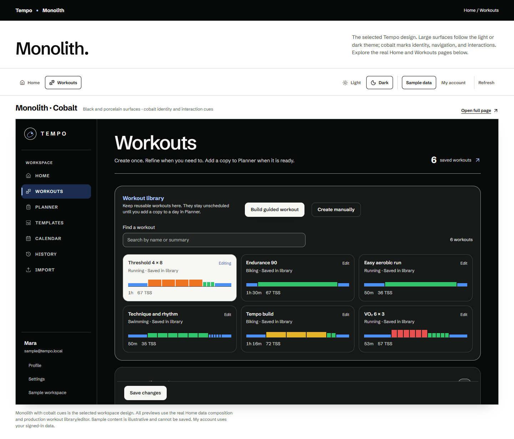

# Monolith Design System Rollout

- **Status:** `in-progress`
- **Agent:** `implementation agent`
- **Started:** `2026-09-29`
- **Updated:** `2026-09-29`
- **Capability IDs:** `DESIGN-001`, `SHELL-001`, `HOME-001`, `LIB-001`, `PLAN-001`, `SESSION-001`, `ACTIVITY-001`

## Goal

Replace the product's previous visual system with the selected **Monolith**
direction across the complete application. Keep the existing product behavior,
routes, permissions, and placement of actions recognizable while rebuilding
the interface around a crisp black and white theme, light and dark modes,
rounded surfaces, restrained cobalt identity cues, and a clear five-color
training-intensity scale. Finish with one production design system and remove
temporary exploration material, including this plan and its screenshots.

This is an implementation handoff. Start from the current branch/worktree and
inspect its changes before editing. Preserve unrelated changes. Do not reset,
checkout, or discard existing files to create a clean baseline.

## Selected design rules

- Black and white define the interface. Light mode should read predominantly
  white with black actions. Dark mode should use layered near-black surfaces
  with porcelain actions and readable near-white text.
- Cobalt is the brand cue for the mark, active navigation, focus and hover
  details. Keep large work surfaces and primary actions neutral.
- Use the existing rounded Monolith geometry for work surfaces, fields, and
  buttons. Maintain clear grouping and scan order; don't turn every region into
  a card.
- Training intensity is the exception to the monochrome interface. Keep its
  semantic progression and interpolate continuously inside each zone:

| Zone | Meaning | Light anchor | Dark anchor |
|---|---|---|---|
| 1 | Recovery | `#2563EB` blue | `#4B91F5` blue |
| 2 | Endurance | `#16A34A` green | `#31C46A` green |
| 3 | Tempo | `#CA8A04` yellow | `#E5B328` yellow |
| 4 | Threshold | `#EA580C` orange | `#F07324` orange |
| 5 | VO2 max | `#DC2626` red | `#E85050` red |

  Zone tints are `#E4EDFF`, `#E1F4E7`, `#FBF1D2`, `#FDE7D9`, and `#FBE4E2` in
  light mode. Use darker coordinated tints in dark mode (`#112744`, `#102F1F`,
  `#372D0D`, `#3D2112`, `#3D191D`). Percentage changes within a zone should
  adjust bar height and move its color smoothly. The boundary between zones
  must not jump; the midpoint uses that zone's anchor. Pauses are neutral.
- Never rely on color alone: retain the zone name/value in text, chart
  descriptions, and accessible labels. Text on zone tint surfaces uses the
  theme's readable ink token.
- Existing features and authorization boundaries are the source of truth for
  behavior. Preserve personal training flows first and keep coach routes
  functional even when they are secondary.

## Reference screenshots

These are screenshots of the actual sample Home and Workouts pages rendered by
the selected Monolith preview, not separate mock pages. They show the deeper
intensity colors and serve as visual references for the rollout.

### Home, light theme

### Workouts, dark theme

The Workouts reference includes the real library and the beginning of its
editor. Open `/design/focus-monochrome` during implementation to inspect the
same pages, switch themes, and compare the current branch against these files.

## Scope and page coverage

Roll the selected style out across existing user-facing pages and shared
components. Preserve each page's current information, actions, responsive
behavior, navigation destinations, and access rules.

- Shared application shell: theme selection and persistence, sidebar, mobile
  navigation, top bar, page frame, buttons, fields, status badges, dialogs,
  notices, empty states, and focus states.
- Athlete Home: today and next-session emphasis, weekly schedule, load and
  history readouts, intensity timelines, and all loading/empty/error states.
- Workouts and templates: saved-workout library, search/filter/sort, guided
  creation, manual builder, target and intensity controls, repetitions,
  summaries, save/delete flows, template browse/edit/apply flows, and mobile
  authoring.
- Planning: athlete Planner, Calendar week/month views, assignment and move
  actions, selected/today states, source pickers, empty states, and coach
  planning surfaces.
- Session lifecycle: planned session detail, workout canvas, block detail,
  live execution, pause/skip/advance, completion, outcome review, and
  planned-versus-actual comparison.
- History and activity: activity list, import/review/match/remove flows,
  telemetry charts, session history, filters, and month/week summaries.
- Account access and settings: sign in/up, reset/setup, profile, preferences,
  and theme controls.
- Coach pages: preserve roster, athlete detail, planning, library, templates,
  sharing, and authorization behavior where these routes remain available.

Do not redesign API contracts, training calculations, persistence formats,
authentication policy, or feature scope as part of the visual rollout. Change
them only when required to make the existing interface work and keep business
logic in its current service owners.

## Implementation sequence

### 1. Audit the working tree and visual ownership

- [ ] Read `README.md`, `docs/agent-workspace/CURRENT-STATUS.md`,
  `docs/agent-workspace/WORK-INDEX.md`, `PRODUCT.md`, `DESIGN.md`, and
  `ARCHITECTURE.md` before editing. Read applicable `AGENTS.md` files.
- [ ] Inspect `git status`, current diffs, routes, shared components, token
  definitions, and imports for `design-preview.css`, `design-overhaul.css`,
  `focus-study.css`, and `focus-monochrome.css`.
- [ ] Make a route/state checklist from the scope above. Identify legacy pages
  that don't use shared components and map each to its current owner before
  adding route-local styling.
- [ ] Treat the attached screenshots as the chosen Home/Workouts composition;
  use the real product components and data contracts everywhere else.

### 2. Establish the production design foundation

- [ ] Make `DESIGN.md` the durable contract for the selected Monolith theme,
  tokens, type, spacing, radii, responsive rules, surface roles, and guardrails.
- [ ] Make `app/globals.css` the shared token and primitive owner. Remove stale
  competing production values; keep preview-only colors scoped to preview
  content until the preview cleanup phase.
- [ ] Implement both themes through the shared shell. Persist user choice,
  honor the existing saved choice on first paint, and check initial loading,
  logged-out routes, and navigation between sections.
- [ ] Audit contrast, focus rings, reduced motion, minimum action sizes, and
  non-color status cues. Retain the existing five-zone continuous intensity
  scale and confirm all zone colors and tints agree between code and docs.
- [ ] Reuse shared primitives for page frames, navigation, controls, dialogs,
  status, and empty states. Avoid parallel component grammars.

### 3. Roll the shell and page families forward

- [ ] Finish the shell first and confirm one responsive navigation model for
  desktop and mobile.
- [ ] Roll out Home, Workouts, and Templates, then Planning and Calendar.
- [ ] Roll out session authoring, detail, live execution, completion, and
  outcome review. Keep workout-target calculations and persistence in existing
  services.
- [ ] Roll out Activity, History, import/review, profile, and settings.
- [ ] Apply the same shared tokens and geometry to any remaining coach pages;
  preserve route access and existing coach behavior.
- [ ] For each family, verify loading, empty, error, selected, hover, keyboard,
  and narrow-width states alongside the populated desktop state.

### 4. Retire the old system and exploration routes

- [ ] Search all imports and class references before removing old design CSS or
  preview components. Move still-used production rules to the shared owner,
  then remove only rules with no production use.
- [ ] Remove the obsolete visual comparison selectors, palettes, route choices,
  and components after confirming no production route depends on them.
- [ ] Keep a single Monolith preview only if it remains useful as a testable
  product preview. Otherwise remove it after all its required acceptance
  evidence is captured.
- [ ] Remove screenshots from earlier discarded directions and references to
  them from docs. Do not leave sample-only styles in the production token
  system.

### 5. Verify behavior, visuals, and documentation

- [ ] Run the repository's required test, lint, type, and build gates when the
  environment allows. Follow current instructions about the database migration
  performed by the build script and the active dev server's `.next` directory.
- [ ] Open the real app in browser at desktop and phone widths. Check Home,
  Workouts/editor, Calendar/Planner, live session, Activity, account flows, and
  each changed coach surface. Capture actual pages, not standalone mockups.
- [ ] Switch light/dark themes and navigate between page families. Check
  readable contrast, chart interpolation, responsive overflow, keyboard focus,
  and that the theme choice persists.
- [ ] Update `CURRENT-STATUS.md` with actual verification results and remaining
  limits. Update `WORK-INDEX.md` owners/status if the implementation changes
  capability ownership.
- [ ] Review the final diff for unrelated edits before committing the completed
  implementation.

## Completion criteria

- [ ] All page families in scope use the one Monolith design system in light
  and dark themes, with their existing behavior and navigation intact.
- [ ] No obsolete visual direction is selectable or styled as a competing
  production system. Temporary comparison routes and unused styles are gone.
- [ ] The five intensity colors remain blue/green/yellow/orange/red and adjust
  smoothly within zones as target percentages change.
- [ ] Browser review covers populated, empty, narrow, and theme-switch states
  across the affected page families; the actual checks are recorded.
- [ ] Required automated gates pass, or a specific environment blocker and the
  equivalent completed checks are recorded.
- [ ] `DESIGN.md`, `CURRENT-STATUS.md`, and `WORK-INDEX.md` match the delivered
  system.
- [ ] **After every completion criterion above is met and reflected in the
  durable docs, remove this task file and the two screenshots in
  `docs/agent-workspace/tasks/assets/`.** Remove their `WORK-INDEX.md` entry in
  the same cleanup change. Do not delete the plan or screenshots before the
  implementation is fully complete and verified.

## Progress

### 2026-09-29

- Change: Chose Monolith Cobalt as the sole direction and deepened the five
  session-intensity anchors slightly. Captured actual Home/light and
  Workouts/dark preview screenshots for the handoff.
- Decision or discovery: Home and Workouts already use the selected real page
  compositions; remaining work is a full route-family audit and consistent
  migration/cleanup across the product.
- Files: `app/globals.css`, `app/focus-monochrome.css`, `lib/tempo-blocks.ts`,
  `components/design/actualPageFixtures.ts`, `DESIGN.md`, screenshots in
  `assets/`.
- Verification: Inspected the screenshots and the live preview. This turn did
  not run automated test/build gates.
- Next step: Start implementation sequence item 1 from the current worktree.

## Completion

- **Final status:** `in-progress`
- **Current docs updated:** `DESIGN.md`; `WORK-INDEX.md` points to this task.
- **Remaining work:** All implementation sequence and completion criteria.
